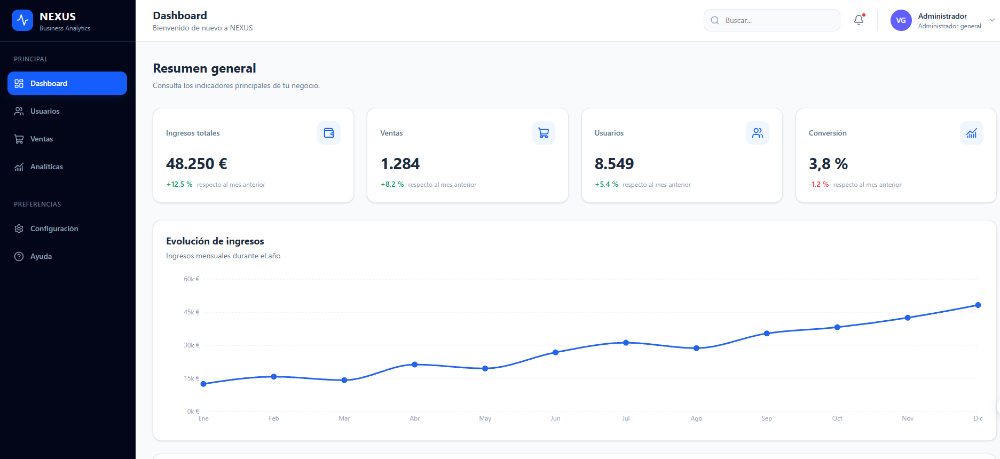
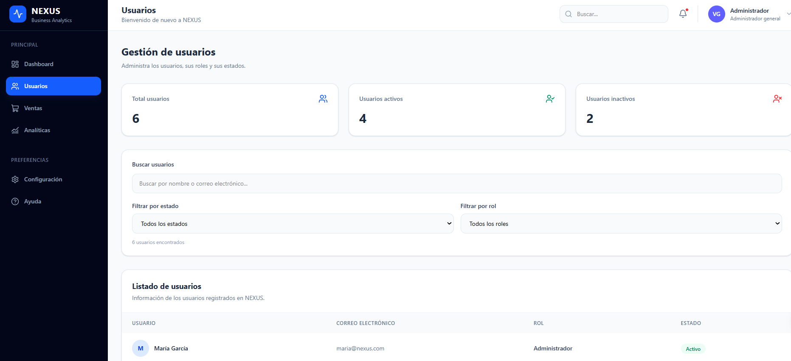
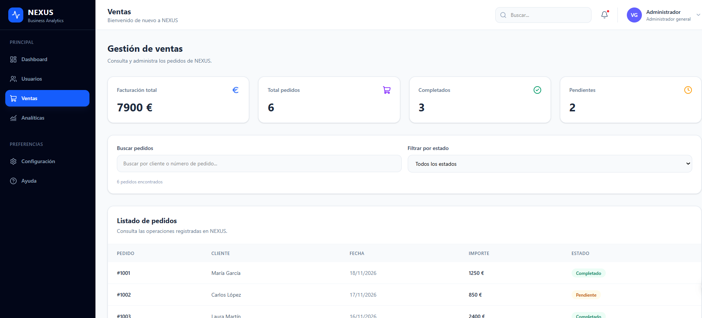
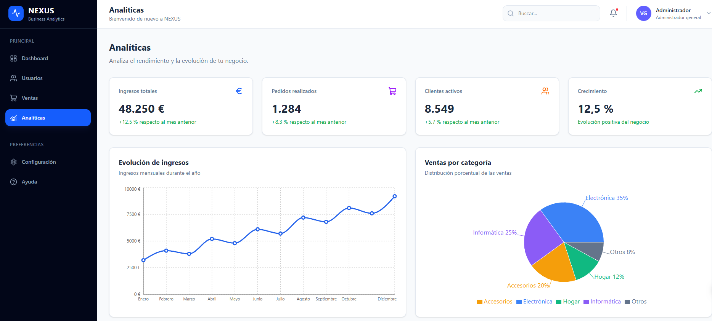
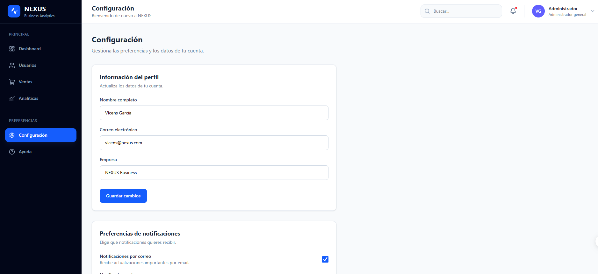
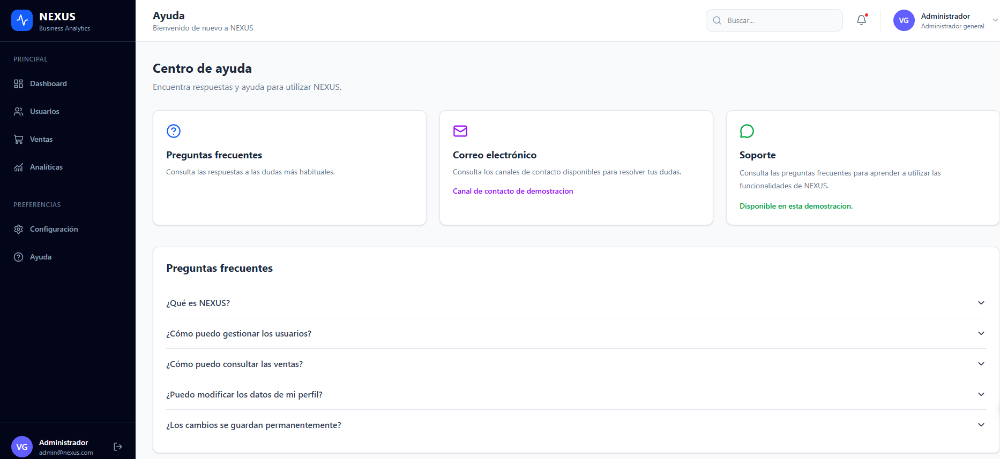

# NEXUS – Business Analytics

Dashboard empresarial desarrollado con React y TypeScript para visualizar y gestionar información relacionada con usuarios, ventas y rendimiento del negocio.

NEXUS es un proyecto de portfolio orientado a demostrar conocimientos de desarrollo frontend, arquitectura de componentes, gestión de estado, visualización de datos y diseño responsive.

## Características principales

### Dashboard
- Indicadores KPI de rendimiento empresarial.
- Gráficas de ingresos y distribución por categorías.
- Tabla de actividad reciente.

### Gestión de usuarios
- Listado de usuarios.
- Búsqueda por nombre y correo electrónico.
- Filtros por rol y estado.
- Paginación de resultados.

### Gestión de ventas
- Listado de pedidos.
- Búsqueda por cliente y número de pedido.
- Filtros por estado.
- Indicadores de ventas y facturación.
- Paginación.

### Analíticas
- Indicadores de rendimiento.
- Gráfica de evolución de ingresos.
- Distribución de ventas por categorías.
- Tabla de resultados y crecimiento.

### Configuración
- Edición de datos del perfil.
- Preferencias de notificaciones.
- Selección de apariencia.

### Centro de ayuda
- Preguntas frecuentes interactivas.
- Tarjetas informativas de contacto y soporte.

# NEXUS – Business Analytics

Dashboard empresarial desarrollado con React y TypeScript para visualizar y gestionar información relacionada con usuarios, ventas y rendimiento del negocio.

NEXUS es un proyecto de portfolio orientado a demostrar conocimientos de desarrollo frontend, arquitectura de componentes, gestión de estado, visualización de datos y diseño responsive.

## Capturas de pantalla

### Dashboard


### Gestión de usuarios


### Gestión de ventas


### Analíticas


### Configuración


### Centro de ayuda


## Características principales

### Dashboard
- Indicadores KPI de rendimiento empresarial.
- Gráficas de ingresos y distribución por categorías.
- Tabla de actividad reciente.

### Gestión de usuarios
- Listado de usuarios.
- Búsqueda por nombre y correo electrónico.
- Filtros por rol y estado.
- Paginación de resultados.

### Gestión de ventas
- Listado de pedidos.
- Búsqueda por cliente y número de pedido.
- Filtros por estado.
- Indicadores de ventas y facturación.
- Paginación.

### Analíticas
- Indicadores de rendimiento.
- Gráfica de evolución de ingresos.
- Distribución de ventas por categorías.
- Tabla de resultados y crecimiento.

### Configuración
- Edición de datos del perfil.
- Preferencias de notificaciones.
- Selección de apariencia.

### Centro de ayuda
- Preguntas frecuentes interactivas.
- Tarjetas informativas de contacto y soporte.

## Tecnologías utilizadas

- **React 19** – Biblioteca para construir interfaces.
- **TypeScript 6** – Tipado estático.
- **Vite 8** – Herramienta de desarrollo y compilación.
- **Tailwind CSS 4** – Framework CSS.
- **React Router 8** – Navegación entre páginas.
- **Recharts** – Visualización de datos.
- **Lucide React** – Iconografía.

## Requisitos previos

- Node.js.
- npm.
- Git (opcional, para clonar el repositorio).

## Instalación y ejecución

1. Clonar el repositorio:

   ```bash
   git clone URL_DE_TU_REPOSITORIO
   ```

2. Entrar en la carpeta:

   ```bash
   cd nexus-dashboard
   ```

3. Instalar dependencias:

   ```bash
   npm install
   ```

4. Iniciar el servidor de desarrollo:

   ```bash
   npm run dev
   ```

5. Abrir en el navegador la dirección local que proporciona Vite.

## Compilación de producción

Para comprobar y generar la versión de producción:

```bash
npm run build
```

Los archivos optimizados se generan en la carpeta `dist`.

## Estado del proyecto

NEXUS es actualmente una demostración frontend.

- Los datos mostrados son ficticios.
- No existe todavía un backend ni una base de datos.
- Los cambios de configuración se gestionan mediante el estado de React y no se guardan permanentemente.
- Las funcionalidades de búsqueda, filtrado y paginación trabajan con datos de demostración.

## Objetivos de aprendizaje

Este proyecto permite practicar:

- Desarrollo de aplicaciones con React y TypeScript.
- Creación de componentes reutilizables.
- Gestión de estado con React Hooks.
- Navegación con React Router.
- Diseño responsive con Tailwind CSS.
- Visualización de datos con Recharts.
- Control de versiones con Git y GitHub.
- Compilación y preparación de aplicaciones para producción.

---

**NEXUS – Business Analytics**  
Proyecto de portfolio de desarrollo frontend.

## Tecnologías utilizadas

- **React 19** – Biblioteca para construir interfaces.
- **TypeScript 6** – Tipado estático.
- **Vite 8** – Herramienta de desarrollo y compilación.
- **Tailwind CSS 4** – Framework CSS.
- **React Router 8** – Navegación entre páginas.
- **Recharts** – Visualización de datos.
- **Lucide React** – Iconografía.

## Requisitos previos

- Node.js.
- npm.
- Git (opcional, para clonar el repositorio).

## Instalación y ejecución

1. Clonar el repositorio:

   ```bash
   git clone URL_DE_TU_REPOSITORIO
   ```

2. Entrar en la carpeta:

   ```bash
   cd nexus-dashboard
   ```

3. Instalar dependencias:

   ```bash
   npm install
   ```

4. Iniciar el servidor de desarrollo:

   ```bash
   npm run dev
   ```

5. Abrir en el navegador la dirección local que proporciona Vite.

## Compilación de producción

Para comprobar y generar la versión de producción:

```bash
npm run build
```

Los archivos optimizados se generan en la carpeta `dist`.

## Estado del proyecto

NEXUS es actualmente una demostración frontend.

- Los datos mostrados son ficticios.
- No existe todavía un backend ni una base de datos.
- Los cambios de configuración se gestionan mediante el estado de React y no se guardan permanentemente.
- Las funcionalidades de búsqueda, filtrado y paginación trabajan con datos de demostración.

## Objetivos de aprendizaje

Este proyecto permite practicar:

- Desarrollo de aplicaciones con React y TypeScript.
- Creación de componentes reutilizables.
- Gestión de estado con React Hooks.
- Navegación con React Router.
- Diseño responsive con Tailwind CSS.
- Visualización de datos con Recharts.
- Control de versiones con Git y GitHub.
- Compilación y preparación de aplicaciones para producción.

---

**NEXUS – Business Analytics**  
Proyecto de portfolio de desarrollo frontend.
